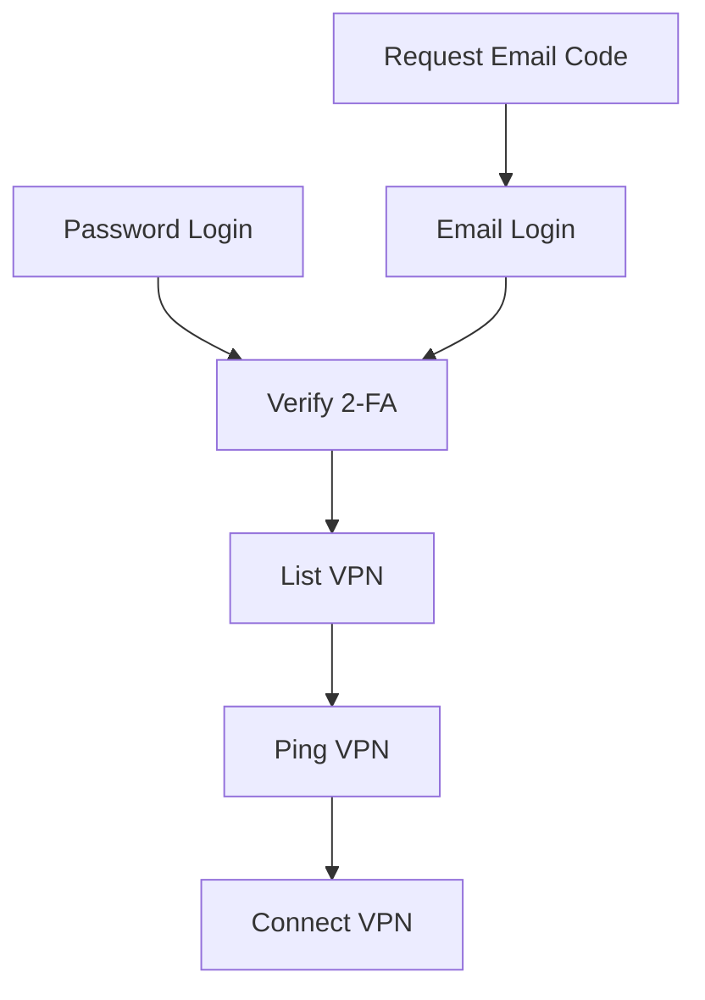
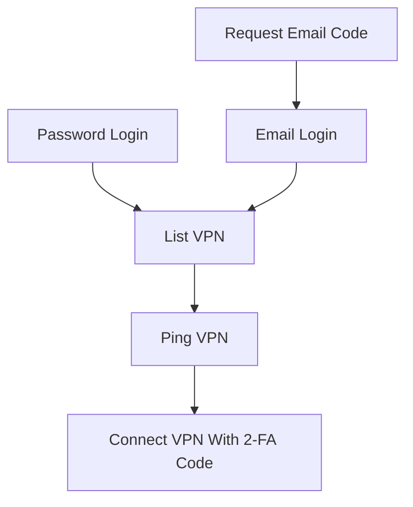

# corplink-rs

使用 rust 实现的 [飞连][1] 客户端，支持 Linux/Windows10/MacOS

# 安装

## 从 release 安装

下载 [release](https://github.com/PinkD/corplink-rs/releases) 中的安装包，并安装

目前支持:

- Linux
  - ArchLinux 有单独打包
  - 欢迎贡献其它包管理器的打包脚本
- MacOS
- Windows

## 安装 master/nightly 版本 

可以从 [nightly.link](https://nightly.link/PinkD/corplink-rs/workflows/release/master) 下载

## 手动编译

### linux/macos

```bash
git clone https://github.com/PinkD/corplink-rs --depth 1
cd corplink-rs
# build libwg
cd libwg
./build.sh
# if you are using Windows, you can clone and build libwg maunally
# ref: wireguard-go/Makefile:libwg
cd ..

cargo build --locked --release
# install corplink-rs to your PATH
mv target/release/corplink-rs /usr/bin/
```

### windows

**前提**: 需要 Go（CI 使用 1.26.10）、GCC (MinGW-w64)、make、Rust (GNU 工具链)。

安装工具链后，在 **PowerShell** 中执行：

```powershell
# 1. 构建 libwg（生成 libwg.a + libwg.h）
cd libwg
.\build.ps1

# 2. 构建 Rust 项目
cd ..
rustup toolchain install stable-gnu
rustup default stable-x86_64-pc-windows-gnu
cargo build --locked --release
```

> 编译的 `build.ps1` 会调用 `make libwg`，该目标会以 `CGO_ENABLED=1` 编译 Go 代码。
> MinGW GCC 需要在 PATH 中，且 make 需要支持 bash 风格环境变量语法。
> 也可在 MSYS2 UCRT64 环境中执行 `./build.sh`（同样需要 Go + GCC）。

# 用法

> **该程序需要 root 权限来启动 `wg-go` (windows 上需要管理员权限)**

```bash
# direct
corplink-rs config.json
# systemd
# config is /etc/corplink/config.json
systemctl start corplink-rs.service
# auto start
systemctl enable corplink-rs.service

# systemd with custom config
# config is /etc/corplink/test.json
# NOTE: cookies.json is reserved by cookie storage
systemctl start corplink-rs@test.service
```

## windows 使用说明

### 快速开始（推荐使用预编译版本）

1. 从 [Releases](https://github.com/PinkD/corplink-rs/releases) 下载 `corplink-rs-*-windows.zip`
2. 解压到任意目录
3. 运行 `setup.ps1` 自动获取 `wintun.dll`：

```powershell
powershell -ExecutionPolicy Bypass -File setup.ps1
```

4. 编辑 `config.json`，填入公司代码和登录信息（见下方配置文件实例）
5. 以**管理员身份**打开 PowerShell，运行：

```powershell
.\corplink-rs.exe config.json

# 调试模式
$env:RUST_LOG="debug"; .\corplink-rs.exe config.json
```

### wintun.dll 说明

`corplink-rs` 依赖 [Wintun][6] 虚拟网卡驱动来创建 WireGuard 隧道。由于 Wintun 的许可证要求用户从[官网][6]直接获取，我们无法在 release 包中附带该文件。

`setup.ps1` 脚本会从 `wintun.net` 下载固定版本，并核对 ZIP 与 `amd64/wintun.dll` 的 SHA-256 后复制到脚本所在目录。已有 DLL 也必须匹配固定校验值；不匹配会停止，不自动覆盖。

手动获取：访问 [wintun.net][6]，下载 zip 包，将 `bin/amd64/wintun.dll` 复制到 `corplink-rs.exe` 所在目录。

### 管理员权限

程序需要管理员权限，原因：
- `wg-go` 需要创建 TUN 虚拟网卡
- 配置系统路由表（自动添加 VPN 路由）

如果运行时提示 `please run as administrator`，右键 PowerShell 选择"以管理员身份运行"。

### 常见问题

- **wintun.dll 找不到**：运行 `setup.ps1` 或手动下载放入同目录
- **配置文件 JSON 不支持注释**：示例中的 `// comment` 需要删除
- **路由未生效**：检查是否以管理员运行，关闭其他 VPN 软件避免路由冲突

## macos 特殊说明

macos 要求 tun 设备的名称满足正则表达式 `utun[0-9]*` ，因此需要将配置文件中的 `interface_name` 改为符合正则的名字，例如 `utun12345`  
另外， `utun` 后的数字类型应该是 `int16` ，如果大于 `32767` 会报错 `Failed to create TUN device: invalid argument` 。具体参考 [#46](https://github.com/PinkD/corplink-rs/issues/46)

## log level 配置

本项目使用 [env_logger](https://docs.rs/env_logger/latest/env_logger/) 作为 log 库，修改 log level 需要使用环境变量，示例：

```bash
RUST_LOG=debug ./corplink-rs config.json
```

# 配置文件实例

最小配置

```json
{
  "company_name": "company code name",
  "username": "your_name"
}
```

推荐配置(自用配置)

```json
{
  "company_name": "company code name",
  "username": "your_name",
  "password": "your_pass",
  "platform": "ldap"
}
```

完整配置

```json
{
  "company_name": "company code name",
  "username": "your_name",
  // support sha256sum hashed pass if you don't use ldap, will ask email for code if not provided
  "password": "your_pass",
  // default is feilian, can be feilian/ldap/lark(aka feishu)/OIDC
  // dingtalk/aad/weixin is not supported yet
  "platform": "ldap",
  "code": "totp code",
  // default is DollarOS(not CentOS)
  "device_name": "any string to describe your device",
  "device_id": "md5 of device_name or any string with same format",
  "public_key": "wg public key, can be generated from private key",
  "private_key": "wg private key",
  "server": "https://vpn.example.com",
  // optional PEM CA bundle, trusted only by this application (not the OS).
  // Leave unset for servers with publicly trusted certificates.
  "ca_cert_file": null,
  // enable wg-go log to debug uapi problems
  "debug_wg": true,
  // will use corplink as interface name
  "interface_name": "corplink",
  // will use the specified server to connect, for example 'HK-1'
  // name from server list
  "vpn_server_name": "hk",
  // latency/default
  // latency: choose the server with the lowest latency
  // default: choose the first available server
  "vpn_select_strategy": "latency",
  // use vpn dns (macOS: networksetup; Linux: preserve /etc/resolv.conf
  //   and atomically replace it with the VPN-provided nameserver).
  // Recovery is journaled and retried at the next DNS-enabled TUN startup;
  // settings changed externally are not overwritten during restoration.
  "use_vpn_dns": false,
  // optional: filename for the Linux backup of /etc/resolv.conf.
  // Default "resolv.conf.corplink", always placed next to /etc/resolv.conf.
  // macOS ignores this field.
  "dns_backup_filename": null,
  // automatically setup system routes (default: true)
  // set to false if you want to manually configure routes
  "auto_setup_routes": true,
  // route mode: "split" (default) or "full"
  // - split: use intranet routes from server (same as official split mode)
  // - full:  use full-tunnel routes from server
  //          often combined with "auto_setup_routes": false in container/gateway setups
  "route_mode": "split",
  // optional CIDRs added to the server-provided routes before filtering. unlike
  // vpn_allowed_routes, this can introduce networks not covered by server routes.
  // the combined routes are still subject to the allowlist and denylist below.
  "vpn_additional_routes": ["20.205.243.160/28"],
  // optional exact hostnames resolved on every VPN connection/reconnection.
  // each IPv4 result is appended as a /32 route; IPv6 results are appended as
  // /128 routes only when the server assigns an IPv6 tunnel address.
  "vpn_additional_domains": ["github.com", "api.github.com"],
  // optional strict CIDR whitelist. each entry is intersected with the routes
  // returned by the server plus the additional routes above. an empty list allows
  // no routes; missing/null preserves all routes. when both lists are set,
  // vpn_disallowed_routes is subtracted after this whitelist. the allowlist must
  // also cover every additional route that should be retained, so leave it unset
  // when using domain routes whose resolved addresses are not known in advance.
  // "vpn_allowed_routes": ["192.168.2.0/24"],
  // optional: list of CIDRs to carve out of AllowedIPs (and system routes).
  // applied as CIDR subtraction: each entry is subtracted from every route
  // returned by the server, so listing a smaller range like "10.68.0.0/16"
  // still punches a hole even when the server returns a supernet like
  // "0.0.0.0/0" (full-tunnel). useful for keeping local LAN traffic off the
  // VPN, and for excluding the VPN peer endpoint IP to avoid a routing loop
  // that would otherwise black-hole all traffic.
  "vpn_disallowed_routes": ["192.168.1.0/24"],
  // optional: run entirely in userspace (gVisor netstack) and expose a SOCKS5
  // proxy at this address instead of creating a kernel TUN device. No system
  // interface, routes, DNS changes or root privileges are required.
  // supports TCP CONNECT and UDP ASSOCIATE; hostnames are resolved in-tunnel.
  "socks5_listen": "127.0.0.1:1080",
  // optional: require SOCKS5 username/password auth (RFC 1929) on the proxy.
  // Both credentials must be nonempty, or both omitted on a loopback listener.
  // A non-loopback listener always requires authentication.
  // UDP ASSOCIATE clients must announce their bound UDP source port (not 0).
  "socks5_username": "user",
  "socks5_password": "pass",
  // optional: force the WireGuard transport ("udp" or "tcp") instead of the
  // server-advertised protocol_mode. some protocol_mode=1 (tcp) gateways also accept
  // WireGuard over UDP -- the server even ships a protocol_detect_config (udp<->tcp switch
  // thresholds) for them in /api/vpn/list. since WireGuard-over-TCP can collapse to a few
  // KB/s on a lossy uplink (TCP-over-TCP), forcing "udp" can be far faster there.
  // leave unset to follow the server's protocol_mode (1 => tcp, otherwise udp).
  "force_protocol": "udp",
  // poll the TPS auth result until approval (5s interval, 180s timeout) instead
  // of waiting for Enter; opt-in because some servers invalidate the auth
  // ticket on the first check. applies to every TPS platform (lark/oidc/weixin/...)
  "poll_tps_auth": false,
  // account type sent in the feilian_v1 login request ("userid" by default).
  // deployments whose login setting advertises another account type (e.g. "email")
  // can override it here
  "account_type": "userid"
}
```

## SOCKS5 / netstack 模式

设置 `socks5_listen` 后，corplink-rs 不再创建内核 TUN 网卡，而是用 [wg-go][2] 的 gVisor netstack 在用户态跑 WireGuard，并在该地址上暴露一个 SOCKS5 代理：

- **无需 root / 不改系统路由和 DNS / 不建网卡**，适合容器、无权限环境或只想给单个应用走 VPN 的场景
- 支持 TCP `CONNECT` 和 UDP `ASSOCIATE`，域名在隧道内解析（用 `--socks5-hostname` 让客户端把 DNS 也交给代理）
- 用户名/密码认证（RFC 1929）：用户名与密码必须同时非空；只有回环地址允许同时省略。监听地址必须是 IP 与端口，例如 `127.0.0.1:1080` 或 `[::1]:1080`。默认应仅监听回环地址。
- UDP `ASSOCIATE` 必须先绑定本地 UDP socket，再在认证后的 TCP 请求中声明该 socket 的非零源端口；来源 IP 必须匹配 TCP 对端。请求端口 `0` 会被拒绝，因此部分通用 SOCKS 客户端的 UDP 功能不兼容；TCP `CONNECT` 不受此限制。
- 服务同时限制最多 128 个客户端会话和 128 个目标连接；超过上限会拒绝新增连接，防止代理无限占用资源。
- RFC 1929 本身不加密密码。即使启用认证，也不要将代理直接暴露在不可信网络上；本地其他用户也能访问免认证的回环监听。

```sh
# 例：通过代理访问内网
curl --socks5-hostname user:pass@127.0.0.1:1080 https://intranet.example.com/
```

此模式下 `interface_name`、`use_vpn_dns`、`auto_setup_routes` 等与系统网卡/路由相关的设置不生效。

# 安全配置与升级说明

- 所有发现、登录、网关 API 请求都要求 HTTPS，并验证证书链和主机名；不跟随重定向，避免认证头被转发到其他来源。私有 CA 部署可配置 `ca_cert_file`（PEM 文件）；相对路径以进程当前目录为准，建议使用绝对路径。该选项仅为本进程增加信任，不安装系统根证书，也不会关闭主机名验证。若网关宣告 IP、证书却仅含 DNS 名称，将拒绝连接；需要修正服务端证书或网关配置。应从管理员通过可信渠道获取并核对 CA，不要为了连通而信任未知证书。
- Unix 下配置及 Cookie 文件以 `0600` 原子保存，新建私有目录使用 `0700`。拒绝符号链接、多硬链接、其他用户拥有的文件，以及其他用户可写的父目录。以 root 运行时，配置必须置于 root 拥有的目录（例如 `/etc/corplink`），不能继续从普通用户的家目录读写秘密；不会自动更改用户目录权限。旧的普通文件权限会在安全检查后迁移为 `0600`。Windows 应自行为配置目录设置仅本人及管理员可读写的 ACL；程序不宣称 Unix mode 位能保护 Windows 文件。
- 密码、Cookie、OTP 种子和 VPN 私钥仍需要在本地使用，文件权限保护并非静态加密。程序不再记录这些秘密或完整 API 响应；TPS 登录链接仅显示在交互终端，无法访问终端时不会将票据写入服务日志。曾由旧版输出的日志和已泄露凭据不因升级自动失效，应单独清理和撤销。
- `use_vpn_dns` 仍默认关闭。macOS 使用 `/var/db/corplink-rs/dns.json` 持久保存恢复信息，并跳过停用的网络服务；Linux 使用 `/etc/<dns_backup_filename>` 及相邻 `.state` 文件。下次启用 DNS 的 TUN 启动会先恢复未完成操作，恢复失败则拒绝继续。若某个曾修改的服务后来被停用或移除，会保留待恢复记录而不触碰该服务；重新启用后可再次恢复。不要删除待恢复日志/备份。恢复仅改回仍等于本程序设置值的配置，保留用户或其他程序的后续修改。强制结束进程后不会有后台服务自动恢复 DNS，需要再次运行客户端。
- TCP 模式客户端只主动连接 VPN 网关，不再开放入站 WireGuard TCP 监听；同一连接上的双向通信保留。

Unix 的 TUN 模式应先将配置放入受保护的应用目录，并显式以 root 运行（读取配置发生在自动提权之前）：

```sh
sudo install -d -m 700 /etc/corplink
sudo install -m 600 config.json /etc/corplink/config.json
sudo corplink-rs /etc/corplink/config.json
```

SOCKS/netstack 模式仍可使用本人拥有的私有配置目录，以普通用户运行。

## 构建与发行验证

CI 的 Go/Rust 工具链使用固定版本，Actions 使用提交 SHA，Rust 构建使用 `--locked`。Arch Linux 依然使用发行版的工具链；`pack/PKGBUILD` 固定两个源码归档及 SHA-256，发布新版本前必须同时更新版本、Go gitlink 和校验值。CI 会拒绝以新标签发布旧配方，或发布与 gitlink 不同的 Go 源码。

发行工作流会生成 `SHA256SUMS` 和 GitHub 构建来源证明，且不覆盖已有同名资产。只有包含这些工作流更改后新生成的发行版才具备它们；这不能追溯证明旧发行版的二进制与源码一致。可用 `gh attestation verify <下载的资产> --repo PinkD/corplink-rs` 验证来源，并核对版本与提交。构建来源证明不等同于 Apple Developer ID 签名或公证，也不保证程序没有漏洞。

# 原理和分析

[飞连][1] 是基于 [wg-go][2] 魔改的企业级 VPN 产品

## 配置原理

魔改了配置的方式，加了鉴权

猜测是：
- 动态管理 peer
- 客户端通过验证后，使用 public key 来请求连接，然后服务端就将客户端的 key 加到 peer 库里，然后将配置返回给客户端，等待客户端连接
    - wg 是支持同一个接口上连多个 peer ，所以这样是 OK 的
- 定时将不活跃的客户端清理，释放分配的 IP
- ...

因此，我们只需要生成 wg 的 key ，然后去找服务端拿配置，然后写到 wg 配置里，启动 wg ，就能连上服务端了

### 后续改动

2.0.9 版本(或者更早)新增了 `protocol_version` 字段，需要使用魔改后的 [wg-corplink][5] 才能连接

## 请求流程


### Linux



### Android



## otp 实现

飞连的 otp 是使用的标准的 [totp][1] ，在 ua 为 Android 时，会在登录时返回 totp 的 token ，然后使用 totp 算法就能生成出当前时间的验证码了，然后在获取连接信息时传输该验证码，就不需要单独验证验证码了

# TODO

- [ ] 使用 [Tauri][7] 实现界面(~~或许大概可能永远不会有~~)
  - 参考实现：https://github.com/huangzheng2016/ecorplink
- [x] 实现 TCP 版的 wg 协议
- [x] 为不同配置生成不同的 `cookies.json`
- [x] windows/mac 实现
- [x] 自动使用从服务器返回的请求中的时间戳同步时间
- [x] 自动生成 wg key
- [x] 修复服务端异常断开连接后客户端不会退出的问题

# Changelog

- 0.5.6
  - add request signing support (@fuergaosi233 @lmxx1234567)
- 0.5.5
  - add more route configs(@yanickxia @zier-one @kfxhjz @ZeppLu)
  - support protocol override config(@n-WN)
  - usermode proxy with socks5(@wilinz)
  - minor fix(@Ben8368 @huangzheng2016)
- 0.5.4
  - fix memory leak in unsafe code
  - refactor error handling with `anyhow`
  - fix default log level
  - add ci for push event(@yanyongyu)
- 0.5.3
  - remove keep-alive api call
- 0.5.2
  - add ipv6 support(@hexchain @ManiaciaChao)
- 0.5.1
  - support using dns from server for macos(@fanwenlin)
  - fix high cpu usage
- 0.5.0
  - add tcp support for wg-go
- 0.4.4
  - add macos release(by @overvenus)
  - fix single ip route(by @simpleapples)
  - add qr code suuport for feishu login(@simpleapples)
- 0.4.3
  - support corplink 2.2.x(by @jixiuf)
- 0.4.2
  - add OIDC platform support(by @Jinxuyang)
- 0.4.1
  - fix Windows device up
  - fix undefined behavior for c str
- 0.4.0
  - embed wg-go with cgo
- 0.3.6
  - fix wg-corplink not exit(by @LionheartLann)
  - fix session is expired(by @XYenon)
- 0.3.5
  - fix empty login method list
  - fix write long data to uapi(by @nolouch)
  - add vpn server name option(by @nolouch)
- 0.3.4
  - fix cookie out of date
- 0.3.3
  - add feishu tps login support
  - upgrade dependency
- 0.3.2
  - separate `cookies.json`
  - add debug flag for wg-go
- 0.3.1
  - fix mac support(on [wg-corplink][5])
- 0.3.0
  - add windows/mac support
- 0.2.3
  - fix empty `protocol_version`
  - add privilege check
- 0.2.2
  - fix wg-corplink not exit if corplink-rs exit accidently
- 0.2.1
  - use modified wireguard-go
    - don't generate config anymore
  - remove `conf_name/conf_dir` and add `interface_name/wg_binary` in config
- 0.1.4
  - get company name from company code automatically
  - support ldap
  - check and skip tcp wg server
  - optimize config
- 0.1.3
  - disconnect if wireguard handshake timeout
- 0.1.2
  - support time correction for totp
- 0.1.1
  - support generate wg key
- 0.1.0
  - first version

# 参考链接

- [wg-go][2]
- [totp][3]
- [python 版本][4]
- [wg-corplink][5]
- [wintun][6]
- [Tauri][7]

# License

```license
 Copyright (C) 2022-2026  PinkD
 Other contributors: https://github.com/PinkD/corplink-rs/graphs/contributors

    This program is free software; you can redistribute it and/or
    modify it under the terms of the GNU General Public License
    as published by the Free Software Foundation; either version 2
    of the License, or (at your option) any later version.

    This program is distributed in the hope that it will be useful,
    but WITHOUT ANY WARRANTY; without even the implied warranty of
    MERCHANTABILITY or FITNESS FOR A PARTICULAR PURPOSE.  See the
    GNU General Public License for more details.

    You should have received a copy of the GNU General Public License
    along with this program; if not, write to the Free Software
    Foundation, Inc., 51 Franklin Street, Fifth Floor, Boston, MA  02110-1301, USA.
```


[1]: https://www.volcengine.com/product/vecorplink
[2]: https://github.com/WireGuard/wireguard-go
[3]: https://en.wikipedia.org/wiki/Time-based_one-time_password
[4]: https://github.com/PinkD/corplink
[5]: https://github.com/PinkD/wireguard-go
[6]: https://www.wintun.net/
[7]: https://github.com/tauri-apps/tauri
